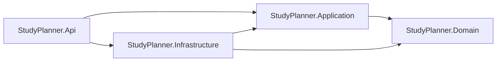

# Kiến trúc backend Study Planner

Ngày ghi nhận: 2026-10-13.

Tài liệu giải thích kiến trúc định hướng cho website lập kế hoạch và tối ưu tiến độ học tập của sinh viên. Đọc cùng [ERD](erd.md) để hiểu dữ liệu và [kế hoạch phát triển](KE-HOACH-PHAT-TRIEN.md) để biết thứ tự triển khai.

## 1. Kiến trúc được đề xuất

Đọc [đặc tả module](modules/README.md) để lần theo nghiệp vụ cần triển khai trong các tầng; nhóm module tài liệu không đồng nghĩa với dịch vụ triển khai độc lập.

Backend là một ứng dụng **monolith**, tổ chức theo **Clean Architecture 4 tầng**, chia chức năng trong từng tầng.

- Monolith: backend chạy và triển khai như một ứng dụng; bản đầu dùng chung PostgreSQL. Bốn project không đồng nghĩa với bốn server hay bốn dịch vụ độc lập.
- Clean Architecture: nghiệp vụ cốt lõi được tách khỏi HTTP, database và các dịch vụ bên ngoài; hướng phụ thuộc đi vào phần nghiệp vụ.
- Chia theo chức năng: code cho nhiệm vụ, học kỳ, thông báo hoặc lập kế hoạch được đặt gần nhau trong tầng tương ứng để dễ lần theo.

Lựa chọn này phù hợp với phạm vi hiện tại vì nhiệm vụ, tiến độ, lịch sử và lời nhắc thường phải cập nhật nhất quán trong cùng giao dịch. Một backend giúp triển khai và chạy demo đơn giản, đồng thời vẫn có ranh giới để kiểm thử và mở rộng nghiệp vụ.

Chưa cần tách microservices, message broker, database riêng cho từng chức năng hoặc CQRS đầy đủ. Chỉ bổ sung khi có yêu cầu và lợi ích cụ thể. Việc chia thư mục chức năng trong tài liệu này chưa phải hệ thống module độc lập có database và hợp đồng riêng.

## 2. Phân biệt hiện trạng với định hướng

Đã đối chiếu code ngày 2026-10-13:

| Hạng mục | Hiện trạng | Định hướng |
| --- | --- | --- |
| Solution | Có Api, Application, Domain, Infrastructure, đều target net10.0; global.json cố định SDK 10.0.400 | Giữ bốn project |
| Tham chiếu project | Application → Domain; Infrastructure → Application/Domain; API → Application/Infrastructure | Giữ hướng này |
| Domain/Application | Chỉ có Class1 rỗng | Thêm mô hình, quy tắc và các chức năng |
| Infrastructure | Có ApplicationDbContext chưa có DbSet; migration InitialCreate rỗng | Triển khai schema theo ERD và truy cập dữ liệu |
| API | Đăng ký DbContext, controllers, Swagger; hai endpoint mẫu và HealthController /health/live | Thêm controller nghiệp vụ và xử lý lỗi/xác thực |
| Routing | Có AddControllers và MapControllers | Giữ cấu hình routing controller |
| Swagger | Swashbuckle 10.3.0, cấu hình tài liệu v1; không còn đăng ký lặp | Tiếp tục bổ sung hợp đồng và xác thực khi triển khai nghiệp vụ |
| ERD | Thiết kế đề xuất 11 bảng | Chưa coi là schema đã triển khai |

HealthController đã có trong code. Các Entity, interface, worker và lớp nghiệp vụ minh họa bên dưới vẫn là đề xuất. Xem [bản ghi nâng .NET 10](history/2026-10-13-nang-cap-dotnet-10.md) để biết phiên bản và kiểm chứng hiện tại.

## 3. Trách nhiệm của từng tầng

### 3.1. Domain — mô hình và quy tắc nghiệp vụ

Chứa entity như User, Semester, Course, TaskItem; enum như trạng thái và độ ưu tiên; các quy tắc tính toán thuần.

Ví dụ: nhiệm vụ hoàn thành phải có tiến độ 100; tiến độ cha tính từ các con; tính hạn hiệu lực từ dữ liệu tổ tiên; chấm điểm ưu tiên nhiệm vụ.

Domain không biết controller, HttpContext, DbContext, SQL hay JWT. Quy tắc nhận dữ liệu cần thiết qua tham số và trả kết quả. Với cây nhiệm vụ, Domain có thể tính trên tập dữ liệu đã tải; việc tải cây và giữ nhất quán giao dịch thuộc Application/Infrastructure.

### 3.2. Application — điều phối chức năng

Chứa use case/application service, DTO, validation và các interface cần để làm việc với lưu trữ, danh tính hoặc thời gian.

Ví dụ: CompleteTaskService kiểm tra người dùng hiện tại, tải nhiệm vụ và tổ tiên, gọi quy tắc tính tiến độ, chuẩn bị lịch sử/lời nhắc và yêu cầu lưu trong cùng giao dịch.

Application quyết định cần đọc/ghi gì và điều kiện thành công; không dùng lớp ApplicationDbContext cụ thể. Có thể bắt đầu bằng service được inject trực tiếp, chưa cần MediatR. Không bắt buộc tạo interface cho mọi service nội bộ nếu chưa có nhu cầu thay thế.

### 3.3. Infrastructure — triển khai kỹ thuật

Chứa ApplicationDbContext, Fluent API, migration, các triển khai repository, giao dịch và xác thực/lưu trữ kỹ thuật.

Ví dụ: TaskRepository triển khai interface do Application khai báo và dùng EF Core để đọc cây nhiệm vụ. Database thực thi FK, unique và CHECK; các điều kiện qua nhiều bảng vẫn cần kiểm tra trong dịch vụ/giao dịch theo ERD.

Infrastructure có thể gọi Domain/Application, nhưng không nên phụ thuộc HttpContext hoặc controller. Việc đọc danh tính từ HTTP đặt tại API rồi cung cấp qua interface ICurrentUser.

### 3.4. API — HTTP và điểm khởi động

Chứa controller, middleware, cấu hình xác thực/phân quyền, ánh xạ lỗi sang HTTP và đăng ký dependency injection trong Program.cs.

Controller nhận request, gọi Application và chuyển kết quả thành response. Các lỗi như không tìm thấy nhiệm vụ, đầu vào sai hoặc xung đột cập nhật cần ánh xạ thống nhất. Không trả nguyên exception hoặc dữ liệu nội bộ cho client.

API tham chiếu Infrastructure để kết nối các triển khai tại điểm khởi động. Điều này không có nghĩa controller được bỏ qua Application và tự truy vấn database.

## 4. Hướng phụ thuộc và luồng chạy

Sơ đồ sau thể hiện **tham chiếu lúc biên dịch**, mũi tên nghĩa là project bên trái phụ thuộc project bên phải:



Domain không tham chiếu ba project còn lại. Application không tham chiếu Infrastructure hoặc API.

Khi chạy, Application gọi interface; dependency injection cung cấp triển khai Infrastructure. Ví dụ ITaskRepository được khai báo trong Application, TaskRepository được viết trong Infrastructure và đăng ký tại điểm khởi động API.

Luồng một request thường là:

```text
Frontend → Controller → Application service
                          ├─ gọi quy tắc Domain
                          └─ gọi interface lưu trữ → Infrastructure → PostgreSQL
Frontend ← HTTP response ← kết quả Application
```

Luồng gọi khi chạy khác hướng tham chiếu project; interface giúp Application sử dụng lưu trữ mà không biết lớp triển khai cụ thể.

## 5. Cấu trúc thư mục định hướng

```text
backend/
├── StudyPlanner.Domain/
│   ├── Entities/
│   ├── Enums/
│   ├── Rules/
│   └── Scheduling/
├── StudyPlanner.Application/
│   ├── Abstractions/
│   │   ├── Persistence/
│   │   ├── Authentication/
│   │   └── Time/
│   └── Features/
│       ├── Auth/
│       ├── Profile/
│       ├── Catalogs/
│       ├── Semesters/
│       ├── Courses/
│       ├── Tasks/
│       ├── Calendar/
│       ├── Notifications/
│       └── Planning/
├── StudyPlanner.Infrastructure/
│   ├── Data/
│   │   ├── ApplicationDbContext.cs
│   │   └── Configurations/
│   ├── Repositories/
│   ├── Authentication/
│   └── Migrations/
├── StudyPlanner.Api/
│   ├── Controllers/
│   ├── Middleware/
│   ├── BackgroundServices/
│   └── Program.cs
└── tests/
    ├── StudyPlanner.UnitTests/
    └── StudyPlanner.IntegrationTests/
```

Ví dụ tổ chức một chức năng:

```text
Application/Features/Tasks/
├── CreateTask/
│   ├── CreateTaskRequest.cs
│   └── CreateTaskService.cs
├── CompleteTask/
│   └── CompleteTaskService.cs
└── Dtos/
    └── TaskResponse.cs
```

Chỉ tạo thư mục/lớp khi triển khai chức năng tương ứng. Không cần tạo sẵn hàng loạt interface rỗng hoặc một service bao toàn bộ nghiệp vụ.

## 6. Ví dụ lần theo chức năng hoàn thành nhiệm vụ

Endpoint minh họa: `POST /api/tasks/{id}/complete`; hợp đồng chính thức cần chốt trước khi code.

1. API xác thực người dùng và kiểm tra định dạng đầu vào; thiếu xác thực trả 401.
2. Application lấy UserId từ ICurrentUser, tìm nhiệm vụ thuộc người đó. Không tin UserId do client gửi; không để lộ dữ liệu tài khoản khác qua phản hồi.
3. Kiểm tra quy tắc: nếu nhiệm vụ còn con thì không cho sửa tay trạng thái cha theo ERD. Nếu là lá, đặt tiến độ 100 và CompletedAt theo thời gian hiện tại qua IClock.
4. Tải dữ liệu cần thiết và tính lại các tổ tiên bằng quy tắc Domain.
5. Chuẩn bị TaskHistory cho các thay đổi, hủy lời nhắc Pending/Failed liên quan theo ERD; không hủy thông báo đã Delivered chỉ vì nhiệm vụ hoàn thành.
6. Infrastructure lưu nhiệm vụ, tổ tiên, lịch sử và thay đổi lời nhắc trong cùng giao dịch. Thất bại thì rollback; không để tiến độ đã đổi nhưng lịch sử chưa ghi.
7. Application trả DTO; API trả response tương ứng.

Application xác định phạm vi giao dịch; Infrastructure thực thi. Các repository tham gia phải dùng chung DbContext/phạm vi giao dịch và không tự commit riêng từng bước. Một SaveChanges có thể đủ cho thay đổi đã theo dõi; luồng nhiều lần lưu hoặc cần khóa nhất quán có thể cần giao dịch tường minh. Giao dịch không tự giải quyết mọi tranh chấp: cần chọn cơ chế khóa hoặc kiểm tra phiên bản khi triển khai cập nhật đồng thời.

## 7. Thiết kế phần tối ưu tiến độ

### Gợi ý thứ tự nhiệm vụ

Application lấy nhiệm vụ lá của người dùng, xác định hạn hiệu lực và chuẩn hóa dữ liệu đầu vào. Bộ tính toán thuần trong Domain/Scheduling nhận hạn, ưu tiên, tiến độ, thời lượng ước lượng còn lại và thời điểm xét; trả danh sách thứ tự kèm lý do/điểm thành phần.

Truyền thời điểm xét vào thuật toán thay vì tự đọc DateTime.Now bên trong để có thể kiểm thử lặp lại. Công thức và trọng số chưa được chốt; cần so sánh với cách đơn giản như sắp theo hạn trên cùng dữ liệu trước khi khẳng định hiệu quả tối ưu.

### Tự phân bổ buổi học

Đây là chức năng mở rộng khác với xếp thứ tự. Nó cần thời gian rảnh, lịch cố định, khoảng học cho phép và mô hình lưu các buổi học được đề xuất/chấp nhận.

ClassSession trong ERD hiện tại là lịch môn học lặp theo tuần; không thay thế bảng buổi tự học được lập kế hoạch. EstimatedMinutes là ước lượng, không phải thời gian thực học. Nếu cần tự xếp lịch hoặc đánh giá thời lượng thực tế, phải bổ sung ERD và hợp đồng API trước khi triển khai.

Khi đánh giá thuật toán, xác định tiêu chí như số việc có thể hoàn thành trước hạn hoặc tổng mức ưu tiên được đáp ứng, cố định đầu vào và mô tả giới hạn. Kiến trúc chỉ giúp tách và kiểm thử thuật toán; bản thân kiến trúc không chứng minh kế hoạch là tối ưu.

## 8. Nhắc hạn và công việc nền

Đề xuất ban đầu dùng BackgroundService trong API host. Worker chỉ điều phối lịch chạy và tạo scope để gọi dịch vụ Application; nghiệp vụ phát thông báo nằm trong Application, truy vấn/khóa dữ liệu nằm trong Infrastructure.

Lưu lời nhắc và trạng thái vào PostgreSQL theo ERD để không phụ thuộc timer trong bộ nhớ. Mỗi lượt xử lý đọc lại nhiệm vụ, hạn hiệu lực và thiết lập trước khi phát; phối hợp cơ chế khóa với luồng sửa nhiệm vụ để tránh phát theo dữ liệu cũ.

Worker chỉ chạy khi backend hoạt động. Nếu host bị dừng hoặc ngủ, thông báo có thể trễ; khi khởi động lại cần xét các lời nhắc đến hạn. Nếu chạy nhiều instance thì cần cơ chế nhận việc/khóa chống xử lý trùng. Có thể tách worker host sau khi vận hành yêu cầu, giữ nguyên dịch vụ Application.

## 9. Quy ước triển khai và kiểm chứng

- Dùng DTO làm hợp đồng API; không trả trực tiếp toàn bộ entity hoặc PasswordHash.
- Repository phục vụ truy vấn và thay đổi có ý nghĩa như tải cây nhiệm vụ; chưa cần generic repository CRUD cho mọi bảng. Nếu thêm abstraction giao dịch, tránh sao chép toàn bộ API của EF Core.
- Quyền sở hữu phải kiểm tra ở mọi đường đọc/ghi, kể cả notification, lịch sử và thao tác với cha/môn; kiểm tra client không thay thế kiểm tra server.
- Dùng UTC cho thời điểm, giữ quy tắc múi giờ/lịch địa phương theo ERD. Truyền CancellationToken qua các thao tác bất đồng bộ phù hợp.
- Log phục vụ chẩn đoán khác TaskHistory phục vụ nghiệp vụ. Không ghi mật khẩu, token hoặc cấu hình bí mật vào log/tài liệu.
- Unit test tập trung tính tiến độ, hạn kế thừa và thuật toán; integration test trên PostgreSQL tập trung FK, CHECK, giao dịch, xóa cây và quyền sở hữu.
- Kiểm thử HTTP tập trung hợp đồng API và luồng chính. Build thành công chưa xác minh database hoặc tính đúng của thuật toán.

## 10. Thứ tự áp dụng vào dự án

1. Chốt chức năng/API theo ERD và các quyết định nghiệp vụ còn mở.
2. Tạo Entity, Fluent API, DbSet và migration; chuẩn hóa Program.cs.
3. Làm xác thực/quyền sở hữu, rồi học kỳ/môn/lịch.
4. Làm nhiệm vụ lá trước; tiếp theo cây tiến độ, lịch sử và nhắc hạn.
5. Tách thuật toán gợi ý, kiểm thử và đánh giá trên bộ dữ liệu cụ thể.
6. Hoàn thiện giao diện, kiểm thử toàn luồng và tài liệu demo.

Chưa cần đổi tên hoặc tạo lại bốn project hiện có. Nội dung này mô tả định hướng tổ chức code; mỗi thay đổi triển khai sau đó phải có bản ghi lịch sử và kết quả kiểm tra thực tế.

## 11. Tài liệu tham khảo

- [Microsoft — Common web application architectures](https://learn.microsoft.com/dotnet/architecture/modern-web-apps-azure/common-web-application-architectures): monolith, phân tầng và hướng phụ thuộc Clean Architecture.
- [Microsoft — Background tasks with hosted services](https://learn.microsoft.com/en-us/aspnet/core/fundamentals/host/hosted-services?view=aspnetcore-8.0): hosted service và scope cho công việc nền.
- [ERD dự án](erd.md): nguồn quy tắc dữ liệu/nghiệp vụ hiện tại; thay đổi quy tắc cần cập nhật thiết kế và lịch sử.
