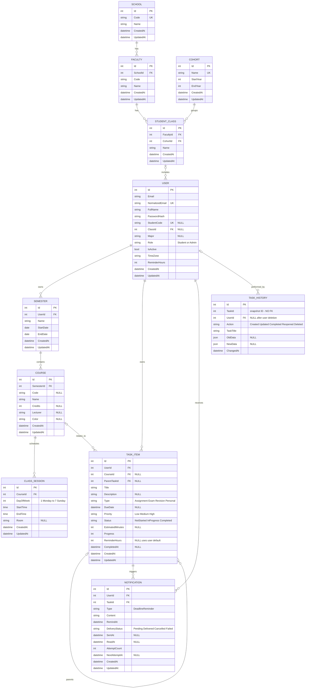

# Cơ sở dữ liệu Study Planner

## 1. Phạm vi và trạng thái

Đây là thiết kế đề xuất cho sinh viên quản lý học kỳ, môn học, lịch học lặp theo tuần, nhiệm vụ, tiến độ, thông báo trong ứng dụng và lịch sử thao tác. Hệ thống có thể gợi ý thứ tự công việc từ hạn, ưu tiên và thời lượng còn lại; chưa lưu kế hoạch tự phân bổ công việc vào từng buổi học.

Thiết kế gồm 11 bảng và 13 đường quan hệ, tính cả quan hệ nhiệm vụ cha–con. Sơ đồ người dùng gửi cũng thực tế có 11 bảng, dù phần mô tả trước đó gọi là 12 bảng. Giữ các bảng này vì đáp ứng phạm vi trên, không coi số bảng là giới hạn cho các lần mở rộng. Trường, khoa, khóa và lớp là danh mục hồ sơ, không bắt buộc để bắt đầu sử dụng ứng dụng. COURSE là môn mà một người dùng thêm vào học kỳ của mình, không phải lớp học phần dùng chung cho toàn trường.

Đối chiếu code ngày 2026-10-13: Domain mới có Class1.cs; ApplicationDbContext chưa có DbSet; InitialCreate có Up/Down rỗng. Sơ đồ dưới đây chưa được triển khai bằng Entity hoặc migration và chưa xác minh database đang chạy.

## 2. ERD

Luồng sử dụng, ngoại lệ và tiêu chí nghiệm thu được mô tả trong [đặc tả từng module](modules/README.md). Các quyết định chưa chốt được tập hợp riêng để rà trước khi triển khai schema/API.

`NULL` nghĩa là có thể bỏ trống; cột không ghi NULL là bắt buộc. Dấu UK biểu thị khóa duy nhất; StudentCode chỉ duy nhất khi có giá trị. Enum trong sơ đồ là tập giá trị nghiệp vụ, không bắt buộc dùng PostgreSQL enum.

## 3. Những quyết định nghiệp vụ

### Tài khoản và danh mục

- Email được trim khi nhập; NormalizedEmail là phiên bản chuẩn hóa do ứng dụng tạo thống nhất khi đăng ký, đổi email và đăng nhập. Khóa duy nhất đặt trên NormalizedEmail để chặn tài khoản trùng theo quy tắc chuẩn hóa của ứng dụng. Không cần một khóa duy nhất riêng trên Email.
- StudentCode là tùy chọn, chuỗi trắng chuyển thành NULL. Bản này giả định mã sinh viên duy nhất trong phạm vi đơn vị triển khai. Nếu triển khai nhiều trường có mã trùng nhau, phải đổi quy tắc này trước khi nhập dữ liệu; không coi mã sinh viên là định danh toàn cầu.
- Role mặc định Student; tài khoản thông thường không tự đổi thành Admin. IsActive mặc định true; quản trị có thể vô hiệu hóa tài khoản mà vẫn giữ dữ liệu. IsActive không thay thế chức năng xóa tài khoản.
- TimeZone mặc định Asia/Ho_Chi_Minh, dùng để hiển thị và xác định ngày/tuần của lịch. Lịch học theo giờ địa phương của tài khoản. Thay đổi TimeZone cần cảnh báo rằng giờ hiển thị deadline thay đổi và lịch học hằng tuần được diễn giải theo múi giờ mới.
- ReminderHours của User mặc định 24. TaskItem.ReminderHours cho phép ghi đè riêng; NULL nghĩa là dùng thiết lập hiện tại của User. Giá trị 0 nghĩa là nhắc đúng hạn. Tắt nhắc toàn bộ chưa nằm trong phạm vi bản này.
- School.Code duy nhất; Faculty.Code duy nhất trong một trường; StudentClass.Name duy nhất trong cùng khoa và khóa. Cohort là danh mục khóa toàn ứng dụng, ví dụ K2026, không phải niên khóa riêng của một trường.

### Học kỳ và lịch học

- Một người có thể có các học kỳ trùng thời gian; không tự cấm nếu chưa có yêu cầu nghiệp vụ.
- ClassSession là mẫu lịch lặp hằng tuần, có hiệu lực từ StartDate đến EndDate của Semester. Một môn có thể có nhiều dòng cho nhiều buổi trong tuần.
- Không tạo sẵn từng ngày học trong database. Khi xem lịch, ứng dụng lấy mẫu lịch và sinh các lần xuất hiện trong khoảng ngày yêu cầu, giới hạn bởi học kỳ.
- Bản này chưa xử lý tuần học luân phiên, nghỉ lễ, nghỉ đột xuất, học bù hoặc đổi phòng riêng cho một ngày. Đây là giới hạn cụ thể; nếu nhóm cần những chức năng đó thì phải bổ sung thiết kế ngoại lệ lịch.
- Credits có thể NULL khi người dùng chưa biết; nếu có giá trị phải lớn hơn 0. Lecturer và Room không bắt buộc để tạo kế hoạch.

### Nhiệm vụ và tiến độ

- DueDate có thể NULL để người dùng ghi lại việc chưa xác định hạn. Nhiệm vụ không hạn vẫn hiện trong danh sách nhưng không xuất hiện như deadline trên lịch và không tạo thông báo hạn.
- Type gồm Assignment, Exam, Revision, Personal. Exam ở đây là một nhiệm vụ có hạn, chưa có thời điểm bắt đầu/kết thúc và phòng thi như một sự kiện thi hoàn chỉnh.
- Priority mặc định Medium, Status mặc định NotStarted, Progress mặc định 0. EstimatedMinutes là ước lượng tổng thời lượng của nhiệm vụ lá, không phải thời gian đã bấm giờ thực tế.
- Nhiệm vụ lá: NotStarted tương ứng Progress = 0; InProgress tương ứng 1–99; Completed tương ứng 100 và có CompletedAt. Cập nhật tiến độ đồng thời cập nhật trạng thái. Đánh dấu hoàn thành đặt Progress = 100. Mở lại cho phép chọn tiến độ 0–99 (mặc định 0), đồng thời xóa CompletedAt.
- Nhiệm vụ cha: nếu tất cả con trực tiếp Completed thì Progress = 100 và Status = Completed; nếu tất cả con có tiến độ 0 thì Progress = 0 và Status = NotStarted; còn lại là InProgress, lấy trung bình cộng tiến độ các con trực tiếp, làm tròn xuống và giới hạn trong 1–99 để không mâu thuẫn với trạng thái. CompletedAt được ghi khi chuyển sang Completed và xóa khi rời trạng thái đó. Không sửa tay tiến độ/trạng thái cha khi còn con. Các con được tính cùng trọng số; đây là lựa chọn đơn giản cho bản đầu, chưa phải tỷ lệ theo khối lượng thực tế.
- Khi thêm, sửa, chuyển hoặc xóa con: tính lại cha cũ, cha mới và các tổ tiên trong cùng giao dịch. Nếu xóa hết con thì giữ tiến độ cuối của cha và chuyển sang quy tắc nhiệm vụ lá. EstimatedMinutes của cha để NULL; thời lượng tổng hợp được tính từ các lá để tránh cộng trùng.
- Nhiệm vụ cha và con phải cùng UserId và cùng CourseId (bao gồm cùng NULL). Không cho tự làm cha, tạo chu trình hoặc gắn vào con/cháu của chính nó. Khi đổi môn của cha phải cập nhật cả cây con trong cùng giao dịch.
- Nếu cha có hạn hiệu lực, các con có hạn không được muộn hơn hạn hiệu lực của cha; con không hạn sử dụng hạn của tổ tiên gần nhất có hạn làm hạn hiệu lực. Nếu không tổ tiên nào có hạn thì con cũng không có hạn hiệu lực. Thay đổi hạn hoặc vị trí trong cây phải kiểm tra lại toàn bộ cây con bị ảnh hưởng.
- Quá hạn được tính bằng hạn hiệu lực < thời điểm hiện tại và Status != Completed; không thêm Overdue vào enum Status. Nhiệm vụ con kế thừa hạn phải được xét cả khi xem lịch, nhắc hạn và gợi ý.
- Gợi ý thứ tự bản đầu có thể xét hạn hiệu lực, Priority và thời lượng ước lượng còn lại của nhiệm vụ lá. Công thức cụ thể phải được thiết kế và kiểm thử riêng; ERD này không khẳng định đã có thuật toán tối ưu.

### Thông báo trong ứng dụng

- Mỗi nhiệm vụ chỉ có tối đa một bản ghi DeadlineReminder, đặt khóa duy nhất (TaskId, Type). Đây là nhắc một lần trước hạn, chưa hỗ trợ nhiều mốc hoặc nhiều kênh.
- Khi nhiệm vụ có hạn hiệu lực và chưa hoàn thành: RemindAt = hạn hiệu lực trừ số giờ nhắc hiệu lực; tạo mới hoặc cập nhật bản ghi nhắc. Nếu mốc nhắc đã qua nhưng hạn còn ở tương lai, lên lịch ngay; nếu nhiệm vụ đã quá hạn thì không tạo một lời nhắc trước hạn mới.
- Đổi hạn, đổi cha làm thay đổi hạn kế thừa, đổi giờ nhắc hoặc đổi mặc định tài khoản: tính lại các thông báo liên quan. Một bản ghi đã Delivered được chuyển về Pending, xóa SentAt/ReadAt và đặt lại bộ đếm nếu người dùng tạo một lịch nhắc mới hợp lệ. Thay đổi này có chủ ý thay thế nội dung nhắc cũ, không giữ lịch sử từng lần gửi.
- Hoàn thành nhiệm vụ: thông báo Pending/Failed chuyển Cancelled. Thông báo đã Delivered vẫn có thể được đọc. Mở lại nhiệm vụ: tính lịch nhắc lại theo quy tắc trên.
- Tác vụ nền lấy thông báo Pending đã đến RemindAt, hoặc Failed đã đến NextAttemptAt và còn lượt thử. Trong giao dịch, khóa dòng thông báo và đọc lại nhiệm vụ cùng thiết lập liên quan để xác minh còn hợp lệ trước khi chuyển Delivered và ghi SentAt. Các luồng cập nhật nhiệm vụ/thiết lập phải đồng bộ cùng bản ghi thông báo; thống nhất thứ tự khóa khi triển khai để tránh chạy song song gây gửi nhắc cũ.
- SentAt là thời điểm thông báo có thể hiển thị trong ứng dụng; ReadAt là thời điểm người dùng đọc. Chỉ hiện DeliveryStatus = Delivered trong hộp thông báo; ReadAt NULL nghĩa là chưa đọc. Không cần lưu thêm IsRead vì có thể suy ra.
- Nếu xử lý lỗi, tăng AttemptCount và ghi NextAttemptAt; tối đa 3 lần thử, sau đó giữ Failed và NextAttemptAt = NULL. Chi tiết lỗi vận hành ghi vào log có kiểm soát, không đưa bí mật vào Content.
- Thiết kế này không bao gồm gửi email/push. Nếu thêm gửi ra ngoài, cần giải pháp chống gửi lặp và xác nhận từ bên cung cấp; không thể chỉ dựa vào SentAt.

### Lịch sử

- TaskHistory.TaskId là số chụp lại, không có FK, nên vẫn lưu được lịch sử khi nhiệm vụ bị xóa. TaskTitle là tiêu đề tại thời điểm thao tác.
- UserId có thể NULL và dùng SET NULL khi xóa hẳn User. Điều này giữ sự kiện nhưng mất liên kết tới người dùng đã xóa. Muốn giữ liên kết để quản trị thì vô hiệu hóa tài khoản; không hứa truy vết danh tính sau khi đã xóa tài khoản.
- OldData/NewData dùng jsonb và chỉ chứa các trường nhiệm vụ nằm trong danh sách cho phép; không sao chép toàn bộ đối tượng User, mật khẩu, token hoặc cấu hình. Created có OldData NULL; Deleted có NewData NULL.
- Ghi lịch sử trong cùng giao dịch với thay đổi nhiệm vụ. Khi xóa cả cây, ghi sự kiện Deleted cho từng nhiệm vụ trước khi xóa; cascade của database tự nó không tạo lịch sử. Khi xóa User cũng phải đi qua dịch vụ xóa để ghi lịch sử trước, rồi FK mới đặt UserId của lịch sử về NULL.
- Lịch sử là dữ liệu riêng tư: người dùng chỉ đọc bản ghi của mình còn liên kết; quyền quản trị và thời hạn lưu dữ liệu phải được quy định khi triển khai.

## 4. Kiểu dữ liệu và ràng buộc

- Id và FK: integer; khóa chính sinh tự động. Cột string cần giới hạn độ dài: Code 50, Name/Title/FullName 200, Email/NormalizedEmail 320, StudentCode 50, Major/Lecturer/Room 200, TimeZone 100, Color 7. Description/Content dùng text; PasswordHash lưu chuỗi hash theo thư viện xác thực, không lưu mật khẩu thô.
- Mọi datetime ánh xạ PostgreSQL timestamptz, trao đổi qua API theo ISO 8601 có offset và lưu thời điểm UTC. date/time của lịch học dùng date và time without time zone. CreatedAt/UpdatedAt bắt buộc, khởi tạo cùng thời điểm; dịch vụ cập nhật UpdatedAt khi dữ liệu thay đổi, không giả định database tự cập nhật cột này.
- Enum có thể lưu chuỗi giới hạn độ dài kèm CHECK cho đúng các giá trị nêu trong sơ đồ; thống nhất với enum C# khi viết Entity.
- CHECK: EndYear >= StartYear; EndDate >= StartDate; DayOfWeek từ 1 đến 7; EndTime > StartTime (chưa hỗ trợ buổi học qua nửa đêm).
- CHECK: Credits IS NULL hoặc > 0; EstimatedMinutes IS NULL hoặc > 0; Progress từ 0 đến 100; ReminderHours của User >= 0; TaskItem.ReminderHours IS NULL hoặc >= 0; AttemptCount >= 0; ParentTaskId IS NULL hoặc khác Id.
- CHECK TaskItem: NotStarted đi với Progress = 0 và CompletedAt NULL; InProgress đi với Progress từ 1 đến 99 và CompletedAt NULL; Completed đi với Progress = 100 và CompletedAt khác NULL.
- CHECK Notification: Delivered phải có SentAt; các trạng thái khác có SentAt NULL; ReadAt chỉ có giá trị khi Delivered và không trước SentAt. Trạng thái Failed có thể có NextAttemptAt để thử lại hoặc NULL khi hết lượt.
- Các chuỗi bắt buộc không được rỗng sau trim. Color nếu có phải đúng dạng #RRGGBB.
- Quy tắc qua nhiều bảng (đúng chủ sở hữu, cây không vòng, hạn cha–con, tổng hợp tiến độ, hiệu lực học kỳ) cần kiểm tra tại dịch vụ trong giao dịch. FK đơn lẻ không tự bảo vệ các quy tắc này. Với truy cập database ngoài ứng dụng, cần bổ sung trigger hoặc ràng buộc phù hợp trước khi cho phép ghi trực tiếp.
- Course của một TaskItem phải thuộc Semester của chính UserId đó; Notification.UserId phải trùng TaskItem.UserId. Mọi API phải kiểm tra quyền sở hữu trước khi đọc/ghi, không tin UserId do client gửi.

## 5. Quy tắc xóa

| Quan hệ, phía được xóa → phía tham chiếu | Hành vi |
|---|---|
| School → Faculty | RESTRICT: còn khoa thì không xóa trường |
| Faculty → StudentClass | RESTRICT: còn lớp thì không xóa khoa |
| Cohort → StudentClass | RESTRICT: còn lớp thì không xóa khóa |
| StudentClass → User | SET NULL: giữ tài khoản, bỏ liên kết lớp |
| User → Semester | CASCADE |
| Semester → Course | CASCADE |
| Course → ClassSession | CASCADE |
| User → TaskItem | CASCADE |
| Course → TaskItem | SET NULL: giữ nhiệm vụ và cây nhiệm vụ |
| TaskItem cha → TaskItem con | CASCADE: xóa cả cây con |
| User → Notification | CASCADE |
| TaskItem → Notification | CASCADE |
| User → TaskHistory | SET NULL: giữ lịch sử, bỏ liên kết tài khoản |

TaskHistory.TaskId không có quan hệ nên không đặt hành vi xóa. Dịch vụ xóa môn/học kỳ phải ghi lịch sử việc CourseId của các nhiệm vụ bị bỏ liên kết trước khi cascade/SET NULL thực thi. Xóa nhiệm vụ con phải tính lại tổ tiên còn tồn tại. Xóa tài khoản là thao tác riêng cần xác nhận trong sản phẩm; không dùng chức năng quản trị danh mục để xóa dữ liệu cá nhân hàng loạt.

## 6. Khóa duy nhất và chỉ mục

| Bảng | Khóa/chỉ mục đề xuất | Mục đích |
|---|---|---|
| User | UNIQUE NormalizedEmail | Đăng nhập và ngăn tài khoản trùng |
| User | UNIQUE StudentCode WHERE StudentCode IS NOT NULL | Không trùng mã khi đã nhập |
| School | UNIQUE Code | Mã trường |
| Faculty | UNIQUE (SchoolId, Code) | Mã khoa trong trường |
| Cohort | UNIQUE Name | Tên khóa dùng chung |
| StudentClass | UNIQUE (FacultyId, CohortId, Name) | Lớp trong khoa và khóa |
| Semester | INDEX (UserId, StartDate) | Lấy học kỳ của người dùng |
| Course | INDEX SemesterId | Lấy các môn của học kỳ |
| ClassSession | INDEX (CourseId, DayOfWeek, StartTime) | Lấy mẫu lịch học |
| TaskItem | INDEX (UserId, DueDate) | Truy vấn hạn đã lưu theo khoảng ngày |
| TaskItem | INDEX (UserId, Status) | Lọc việc chưa hoàn thành |
| TaskItem | INDEX ParentTaskId; INDEX CourseId | Duyệt cây và lấy nhiệm vụ theo môn |
| Notification | UNIQUE (TaskId, Type) | Một lời nhắc hạn cho mỗi nhiệm vụ |
| Notification | INDEX (UserId, SentAt) WHERE DeliveryStatus = 'Delivered' | Hộp thông báo đã phát |
| Notification | INDEX (UserId, SentAt) WHERE DeliveryStatus = 'Delivered' AND ReadAt IS NULL | Thông báo chưa đọc |
| Notification | INDEX RemindAt WHERE DeliveryStatus = 'Pending' | Quét các lời nhắc đến giờ |
| Notification | INDEX NextAttemptAt WHERE DeliveryStatus = 'Failed' AND NextAttemptAt IS NOT NULL | Quét lần thử lại |
| TaskHistory | INDEX (UserId, ChangedAt); INDEX (TaskId, ChangedAt) | Lịch sử người dùng và nhiệm vụ |

Thêm chỉ mục đơn cho các FK chưa được bao phủ ở vị trí đầu của chỉ mục: User.ClassId, StudentClass.CohortId. Không tạo thêm chỉ mục đơn nếu đã có chỉ mục ghép bắt đầu bằng chính FK đó mà đáp ứng truy vấn.

Chỉ mục (UserId, DueDate) không trực tiếp tăng tốc hạn kế thừa từ cha. Với cây nhiệm vụ, truy vấn phải tính hạn hiệu lực bằng truy vấn đệ quy hoặc lấy cây của người dùng để tính ở ứng dụng. Chỉ bổ sung cột hạn hiệu lực đã tính và cơ chế đồng bộ nếu số liệu đo thực tế cho thấy cần tối ưu.

## 7. Ví dụ lần theo dữ liệu

1. Sinh viên đăng ký → User; không cần chọn trường/lớp ngay.
2. Tạo học kỳ → Semester với UserId lấy từ phiên đăng nhập.
3. Thêm môn CSDL và hai buổi học → một Course, hai ClassSession; lịch hiển thị các lần lặp trong học kỳ.
4. Tạo bài tập CSDL hạn thứ Sáu → TaskItem; tạo TaskHistory.Created và Notification.Pending trong cùng giao dịch.
5. Chia bài tập thành hai phần → hai TaskItem con, cùng chủ sở hữu và môn; tính lại tiến độ cha. Hạn để trống của con kế thừa từ cha.
6. Cập nhật một phần lên 60%, phần còn lại 0% → tiến độ cha 30%, trạng thái InProgress; ghi lịch sử các thay đổi.
7. Đổi hạn bài tập → kiểm tra hạn các con, tính lại lời nhắc cha và các con kế thừa hạn; ghi lịch sử.
8. Tác vụ nền đến giờ → phát thông báo hợp lệ trong ứng dụng; người dùng đọc → ghi ReadAt.
9. Xóa môn CSDL → lịch học bị xóa, nhiệm vụ vẫn còn với CourseId NULL; lịch sử việc bỏ liên kết được dịch vụ ghi lại.

Bản hiện tại nhắc mọi nhiệm vụ đủ điều kiện, bao gồm nhiệm vụ con; một bài tập đã chia nhỏ có thể tạo nhiều thông báo. Đây là hành vi cần thể hiện rõ cho người dùng. Nếu cần tùy chọn tắt nhắc từng nhiệm vụ thì phải thêm trường bật/tắt và sửa quy tắc tạo thông báo trước khi viết migration.

## 8. Bước triển khai và giới hạn kiểm chứng

Tiếp theo mới viết Entity, Fluent API, migration và các dịch vụ xử lý cây nhiệm vụ/thông báo theo tài liệu này. Cần kiểm tra migration trên PostgreSQL, đặc biệt xóa học kỳ, xóa cả cây, xóa User giữ lịch sử, ngăn truy cập chéo người dùng và cập nhật đồng thời giữa tác vụ nền với sửa nhiệm vụ.

Tài liệu được kiểm tra cấu trúc và đối chiếu code nền; chưa chạy migration, truy vấn hoặc thử các luồng trên database. Mermaid được viết theo cú pháp erDiagram nhưng chưa render bằng công cụ Mermaid trong tác vụ này.
